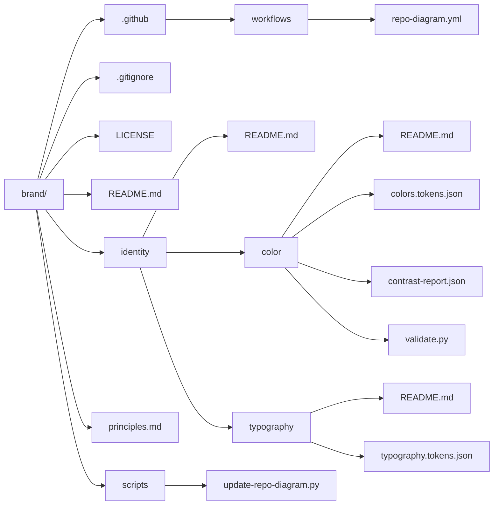

# Can Aslan — Brand

Public documents and resources for my design principles and visual identity.

This repository includes my design principles, color system, and typography tokens. Further brand and identity documentation will be added as it is ready.

## Start here

- [Design principles](principles.md): beliefs that guide my work.
- [Visual identity](identity/README.md): visual direction and identity resources.
- [Color](identity/color/README.md): palette, semantic tokens, import guidance, and validation.
- [Typography](identity/typography/README.md): typefaces, shared tokens, and units.

## Repository structure



## Working with this repo

Keep design principles in `principles.md` and visual identity resources in `identity/`. Keep each identity resource's guidance, source files, and supporting tools together, as the color folder does.

Edit color values in `identity/color/colors.tokens.json`, then run this command from the repository root:

```sh
python3 identity/color/validate.py
```

Commit the regenerated contrast report with token changes. Any future CSS or other platform exports should be generated from the token source rather than maintained as separate palettes.

Add logos, imagery, or component documentation when those resources exist. A separate component design system is not part of v1.0. Use lowercase, hyphen-separated filenames and relative Markdown links between documents.

## License

See [LICENSE](LICENSE).
